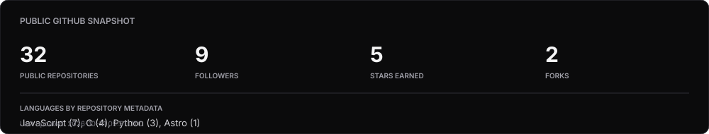

<div align="center">


<br/>


<br/>

<a href="https://github.com/vinayak-h">GitHub</a> ·
<a href="https://www.linkedin.com/in/vinayak-hegde-5b5b77255/">LinkedIn</a> ·
<a href="https://voidstack-eta.vercel.app/">Portfolio</a>

<br/>

<sub>Engineering-focused. Curious by default. Always building.</sub>

</div>

---

## About

I'm a software engineer focused on Java backend development. I enjoy understanding how systems work end to end — from API design and persistence to integration, debugging and deployment.

- **Backend:** Java, Spring Boot, REST APIs, Hibernate/JPA
- **Database:** SQL, PostgreSQL, MySQL
- **Frontend:** React, JavaScript, Vite, Tailwind CSS
- **Interests:** System design, microservices, distributed systems and applied AI/ML
- **Currently:** Building practical software projects and strengthening backend engineering skills.

## Selected work

<table>
<tr>
<td width="50%" valign="top">

<h3><a href="https://voidstack-eta.vercel.app/">VoidStack ↗</a></h3>

A technology-focused website featuring developer resources and technical articles.

<sub>Website · Technology</sub>

</td>
<td width="50%" valign="top">

<h3><a href="https://github.com/vinayak-h/KnowledgeBridge">KnowledgeBridge ↗</a></h3>

A knowledge-management application focused on organizing and accessing information.

<sub>Repository · Software project</sub>

</td>
</tr>
</table>

Explore more: <a href="https://github.com/vinayak-h?tab=repositories">All repositories</a>

## Technology

<div align="center">


</div>

<details>
<summary><strong>Technical areas</strong></summary>

| Area | Technologies and concepts |
|---|---|
| Programming | Java, Python, JavaScript |
| Backend | Spring Boot, REST APIs, Hibernate/JPA |
| Database | PostgreSQL, MySQL, SQL |
| Architecture | Microservices, system design, integration patterns |
| Frontend | React, Vite, Tailwind CSS |
| DevOps | Docker, Git, GitHub Actions, Linux |

</details>

---

## GitHub activity

<div align="center">



<br/>


<br/>


</div>

<sub>Account and repository metrics are generated from GitHub's public API. Contribution activity is provided by GitHub and the contribution-snake workflow. External statistics services may occasionally be unavailable.</sub>

## Currently listening

<div align="center">


</div>

<sub>Optional Spotify integration. Displays the currently playing track when Spotify credentials are configured and playback is active.</sub>

---

## Beyond the code

<details>
<summary><strong>Developer console</strong></summary>

```text
vinayak@github:~$ whoami

Vinayak Hegde

vinayak@github:~$ interests

Backend engineering
Java ecosystem
System design
Distributed systems
Artificial Intelligence

vinayak@github:~$ philosophy

Understand the problem.
Build the simplest reliable solution.
Measure it.
Improve it.

vinayak@github:~$ exit

Thanks for stopping by.
```

</details>

<details>
<summary><strong>Currently exploring</strong></summary>

- Building maintainable Spring Boot services
- REST API design and backend architecture
- SQL performance and database modelling
- Distributed systems and microservice trade-offs
- Docker and CI/CD workflows
- Practical machine learning applications

</details>

---

<div align="center">

**Thanks for visiting.**

Always open to interesting engineering discussions and opportunities to build something meaningful.

<br/>

<a href="https://github.com/vinayak-h">GitHub</a> ·
<a href="https://www.linkedin.com/in/vinayak-hegde-5b5b77255/">LinkedIn</a> ·
<a href="https://voidstack-eta.vercel.app/">VoidStack</a>

<br/><br/>

<sub>Minimal by design. Built with Markdown, SVG and GitHub Actions.</sub>

</div>
